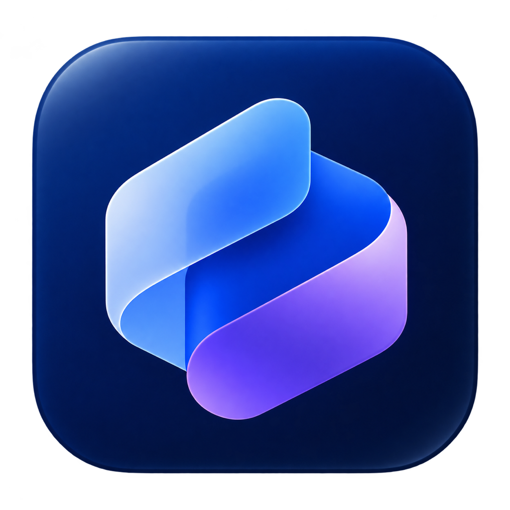

# Ayrvo



[](https://github.com/d4rk413x21/Ayrvo/actions/workflows/ci.yml)
[](LICENSE)

**Turn meeting conversations into notes and development tasks you can review.**

Ayrvo is a macOS menu bar app that records both sides of a conversation, transcribes
speech on your Mac, and helps turn explicit requests into context-rich task drafts.
Review the transcript, source quotations, and owners before publishing selected
issues to Linear.

## Features

- **Meeting capture:** record your microphone and system audio, with optional
  meeting detection and calendar matching.
- **On-device transcription:** use Apple Speech or supported Parakeet models,
  with speaker attribution and editable transcripts.
- **Notes and organization:** edit meeting notes, use summary templates, search
  your library, and organize meetings into folders.
- **Reviewed development tasks:** extract drafts through a configured AI CLI,
  retain supporting transcript passages, and review what becomes work.
- **Linear integration:** publish selected drafts, retain issue links, and recover
  from interrupted exports without blindly creating duplicates.
- **Assistant access:** read meetings through the bundled CLI, or connect an MCP
  client to work with the library.

Ideas, open questions, and tentative suggestions should remain distinguishable
from explicit requests. Model output still requires human review.

## Requirements

| Component | Requirement |
| --- | --- |
| Platform | Apple Silicon Mac running macOS 26 or later |
| Recording | Microphone and system audio access |
| AI CLI | Claude Code, Codex, OpenCode, or Mistral Vibe, configured with an account and model |
| Calendar | Optional; used for event matching and the Coming up view |
| Accessibility | Optional; used for supported meeting-client speaker attribution |
| Linear | Optional personal API key for issue export |

Apple Intelligence is an optional summary provider. It is not required when you
use a supported AI CLI. Task extraction uses a supported CLI.

## Installation

When a packaged release is available, download **Ayrvo.zip** from
[Releases](https://github.com/d4rk413x21/Ayrvo/releases), extract it, and move
**Ayrvo.app** to Applications.

To get a preview without installing Xcode:

1. Open [Actions → CI](https://github.com/d4rk413x21/Ayrvo/actions/workflows/ci.yml).
2. Select **Run workflow** and choose the branch you want to try.
3. After the run succeeds, download the **Ayrvo-preview** artifact and extract
   `Ayrvo.zip`.
4. Move `Ayrvo.app` to Applications and launch it.

Preview artifacts require a GitHub account to download. Builds use ad-hoc signing,
so macOS may ask you to approve opening the app and grant recording permissions.

### Upgrading from Nutola

Quit Nutola before opening Ayrvo. These builds share the same macOS application
identity and are intended to replace each other, rather than run side by side.

Ayrvo retains the existing `io.github.d4rk413x21.Nutola` bundle identifier, preference
domain, Linear Keychain service, and `~/Library/Application Support/Nutola/` storage
location. The rename does not move recordings, duplicate model downloads, or
intentionally reset preferences or credentials. macOS may still request permission
confirmation when replacing an ad-hoc-signed build.

Existing CLI scripts and MCP registrations that point at `Nutola.app` need to be
updated to the new executable path. Reconfigure the connector in
**Settings → Intelligence** using the name `ayrvo`.

## Getting started

1. Open Ayrvo and complete the permissions walkthrough.
2. Configure your chosen AI CLI outside the app, then select it in
   **Settings → Intelligence**.
3. Start a recording from the menu bar, or accept the meeting-detection prompt.
4. When processing finishes, review the transcript and speaker names.
5. Edit the notes, or open **Development tasks** to extract and review task drafts.

Claude and Codex binaries bundled with VS Code and VS Code Insiders are also
detected. OpenCode and Mistral Vibe use their existing CLI configuration.

### Speaker names in Google Meet

For supported Google Meet attribution, use Chrome, grant Ayrvo Accessibility access,
and turn on Meet captions. Keep the meeting selected in its Chrome window; Chrome
can remain behind Ayrvo. Italian and English Meet layouts are supported. Opening
the **People** panel also makes participant names available.

Current caption speaker labels supplement on-device transcription and diarization.
Stale captions, a different meeting tab, or ambiguous simultaneous speakers do not
provide a reliable name. Caption text does not replace the recorded transcript.
Other browsers can still be recorded without this name integration.

**Muting your microphone in Meet does not pause Ayrvo's microphone recording.**

## From a meeting to Linear

1. Open **Development tasks**, choose a CLI, and select **Extract tasks**.
2. Review titles, descriptions, owners, and quoted evidence.
3. Use **Save & Close** to retain drafts, or **Copy selected drafts** for Markdown.
4. To publish issues, connect a personal API key in **Settings → Integrations**.
5. Choose a **Team**, optionally a **Project**, select the drafts, and use
   **Create / retry issues**.

The key needs access to teams, projects, and issues, plus permission to create
issues. Owner names remain in descriptions; Ayrvo does not infer Linear assignees.
Only selected descriptions and their supporting transcript passages are published.

Exports persist stable issue IDs and checkpoints. Retry checks for existing issues
before sending another create request. Once an export starts, task removal and
re-extraction are disabled to preserve those checkpoints. Edit published issues in
Linear; retry recovers links and does not apply later draft edits. Disconnecting
Linear keeps the created issues and their saved links.

## CLI and MCP

The installed app includes a read-only meeting CLI:

```sh
/Applications/Ayrvo.app/Contents/MacOS/Ayrvo meetings help
/Applications/Ayrvo.app/Contents/MacOS/Ayrvo meetings list --limit 10
```

For assistant access, use the connector instructions in **Settings → Intelligence**.
The same binary starts the MCP server with `--mcp`. Unlike the read-only CLI, MCP
also exposes editing and deletion tools; grant only the access you intend to use.

## Data and privacy

- Audio capture and transcription run on your Mac. Models may be downloaded when
  needed.
- Summaries, chat, and task extraction follow the selected provider. An AI CLI may
  send meeting text through its configured account and model.
- Linear receives selected task content. Connecting also loads workspace, team,
  and project metadata. API keys are stored in the macOS login Keychain.
- Sharing uses local HTML files or the clipboard. HTML, Markdown, PDF, CSV, and
  subtitle exports are available without an online publishing service.

Recordings, transcripts, notes, and drafts remain in
`~/Library/Application Support/Nutola/`. Back up this directory to retain your
library. This legacy path is preserved for compatibility with existing installs.

If saving fails, keep Ayrvo open and use **Retry saving**. The latest unsaved file
contents remain in memory; quitting before a successful save can discard them.

## Development

Building the complete app requires **Xcode 27.1 with Swift 6.4**. This build-tool
requirement is separate from the macOS 26 minimum runtime requirement. GitHub
Actions provides the configured toolchain when a local Xcode installation is not
available.

```sh
git clone https://github.com/d4rk413x21/Ayrvo.git
cd Ayrvo
make test    # Build and run the Swift Testing suite
make app     # Build and verify dist/Ayrvo.app
```

`make install` additionally installs the app in `/Applications/Ayrvo.app`.
Tests use Swift Testing from the toolchain; no separate testing dependency is
needed. Suites that share process-wide state are serialized. Tests requiring
Apple Intelligence are skipped when that provider is unavailable.

The executable product is `Ayrvo`. Source and test module names retain `Nutola`
internally to keep the rename focused on application identity and compatibility.
The `zoom-info` executable remains a separate utility.

Publishing a versioned GitHub release triggers the release workflow, which builds
and attaches `Ayrvo.zip`. CI also assembles a preview when packaging changes or the
workflow is started manually.

## Contributing and support

For reproducible bugs and feature proposals, open an
[issue](https://github.com/d4rk413x21/Ayrvo/issues). Include the app version, macOS
version, reproduction steps, and expected behavior. Remove personal meeting
content and credentials from diagnostic material.

See [CONTRIBUTING.md](CONTRIBUTING.md) for the development and pull request workflow.

## Acknowledgements

Ayrvo is maintained as an independent continuation of the Nutola codebase. Its Git
history and original attribution notices are retained.

- [Nutola/Nutola](https://github.com/Nutola/Nutola), previously hosted at
  `maatheusgois-dd/Nutola`, and the
  [Nutola adaptation](https://github.com/d4rk413x21/Nutola) from which Ayrvo was created.
- [conrad-vanl/parfait](https://github.com/conrad-vanl/parfait), which provided the
  original architecture and audio/transcription workflow.
- [FluidAudio](https://github.com/FluidInference/FluidAudio) (Apache-2.0) for speaker
  diarization. Associated model weights derive from
  [pyannote](https://github.com/pyannote/pyannote-audio) and
  [WeSpeaker](https://github.com/wenet-e2e/wespeaker) (CC-BY-4.0).
- [Granola](https://granola.ai) for inspiration for the meeting-notes experience.
- [anarlog](https://github.com/fastrepl/anarlog), which also uses the Soniqo model weights.

## License

[MIT](LICENSE). The original copyright and license notices are preserved.
